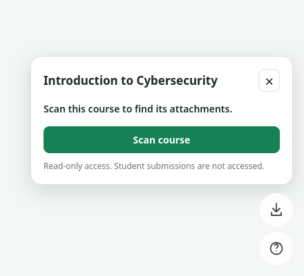
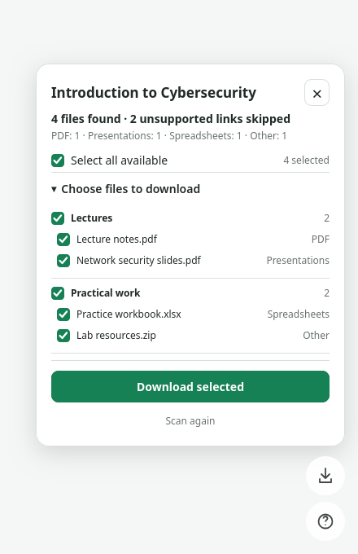

# Classroom Downloader

Download your Google Classroom course files in one ZIP, directly from Classroom.

  
  

*Screenshots use sample course files.*

## Features

- Select individual files or whole Classroom topics.
- Save one ZIP with one location prompt.
- Export Google Docs and Slides as PDF, and Sheets as XLSX.
- Keep scans and selections when switching course views or courses.
- Track progress, cancel downloads, and review failed files.
- Lightweight vanilla JavaScript. No build step, dependencies, or tracking.

## Installation

Requires **Firefox desktop 140+** and [Google OAuth setup](docs/SETUP.md).

1. Download and extract this repository, or clone it.
2. Complete the [setup guide](docs/SETUP.md).
3. Open `about:debugging` in Firefox.
4. Choose **This Firefox → Load Temporary Add-on**.
5. Select `manifest.json`, then open [Google Classroom](https://classroom.google.com/).

Temporary add-ons are removed when Firefox restarts. No signed release is available yet.

## Usage

Open a course and click the download icon above Classroom’s **?** button. Choose **Scan course**, authorize your Classroom account, then select the files or topics you want.

Click **Download selected**, choose where to save the ZIP, and extract it. Afterward, use **Show in folder**, **Choose more files**, or **Scan again**.

| File type | Download format |
| --- | --- |
| Google Docs / Slides | PDF |
| Google Sheets | XLSX |
| PDFs, Office files, images, ZIPs and other ordinary Drive files | Original format |

## Limitations

- Downloads respect Google permissions and administrator restrictions. External links, unsupported Google file types, and student submissions are excluded.
- Maximum **100 MiB per file** and **256 MiB per ZIP**. Google’s export limits also apply.
- Course memory lasts until the extension unloads or Firefox restarts. Use **Scan again** to refresh cached results.
- Classroom changes may require updates. Complete course coverage is not guaranteed; see the [verification record](docs/TESTING.md).

## Privacy & permissions

No analytics or extension servers. Requests go directly to Google through the official Classroom and Drive APIs. Scan results and access tokens stay in browser memory; Google passwords never enter the extension.

| Permission | Purpose |
| --- | --- |
| `downloads` | Save, cancel, track and locate the extension’s ZIPs. |
| `identity` | Google authorization. |
| `classroom.google.com` | Display the panel and identify the current course. |
| `classroom.googleapis.com` | Read course attachments and topics. |
| `www.googleapis.com` | Read Drive metadata, download and export files. |
| `oauth2.googleapis.com` | Exchange the authorization code for an access token. |

## Development & contributing

No installation or build step is needed. With Node.js 20+, run `npm test` and `npm run check`. See [development notes](docs/DEVELOPMENT.md) and the [Firefox checklist](docs/TESTING.md).

Bug reports and pull requests are welcome. Include steps to reproduce and Firefox version; omit credentials, student information, and private course files.

## License

[MIT](LICENSE). Independent project, not affiliated with Google or Mozilla.
